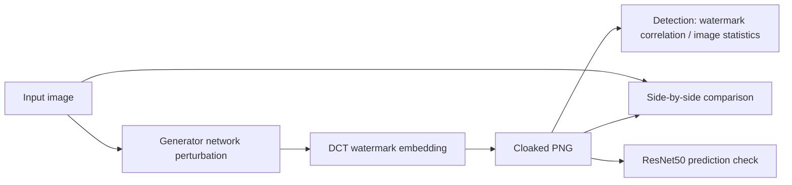

# DeepShield

An image **"cloaking" toolkit** with desktop (Tkinter) tools. It perturbs a picture with a small convolutional generator network, embeds an invisible DCT-domain watermark, and lets you detect and compare cloaked images. The idea is to make profile photos harder for AI systems to use, while looking almost unchanged to people.

> **Status:** experimental / learning project. The generator in `utilites1.py` is built with Keras and no trained weights are included, so no protection guarantees are made.

## What's in the repo

| File | What it does |
|---|---|
| `Deepshield_main1.ipynb` | Notebook with all pieces in one place: cloaking utilities, cloak app, detection app, comparison toolkit, and a ResNet50 test |
| `utilites1.py` | Core utilities: generator (`build_generator`), DCT watermark embed/detect, `cloak_image`, `is_cloaked`, `compare_images`, and `run_ai_disruption_test` (compares ResNet50 ImageNet predictions on original vs cloaked image) |
| `GAN_pertubations2.py` | Tkinter app "Cloak Image": pick an image, add a text watermark (text, size, colour, position), save the result |
| `Detector3.py` | Tkinter app "Detect Cloaking": check whether a selected image looks cloaked |
| `comparision4.py` | Tkinter "AI Cloaking Toolkit" with two tabs: detection and original-vs-cloaked comparison (saves images to `comparison_images/`) |

## How it works



## Requirements

Python 3.9+ with Tkinter (bundled with most Python installers; on Debian/Ubuntu: `sudo apt install python3-tk`).

```bash
git clone https://github.com/Abhishek7258/Deepsheild.git
cd Deepsheild
python -m venv .venv
# Windows: .venv\Scripts\activate    macOS/Linux: source .venv/bin/activate
pip install -r requirements.txt
```

## Usage

```bash
python GAN_pertubations2.py   # cloak / watermark an image
python Detector3.py           # detect whether an image is cloaked
python comparision4.py        # detection + comparison toolkit
```

Or open `Deepshield_main1.ipynb` in Jupyter and run the cells in order. The first ResNet50 test downloads the ImageNet weights, so it needs internet access.

## Notes

- Watermark key and strength are constants near the top of `utilites1.py` (`WATERMARK_SECRET_KEY`, `WATERMARK_STRENGTH`). Replace the key with your own before real use.
- The code files are named with numeric suffixes (`Detector3.py`, etc.) from development; the apps are standalone scripts, not an installable package.
- `GAN_pertubations2.py` uses `arial.ttf` for the text watermark; change the font on systems without it.

## Roadmap ideas

- Train or load real generator weights and document the results
- Share one code path between the notebook and the scripts
- Add sample before/after images
